# 🧠 Deep Learning Practical Exam — Set C

This repository contains the practical notebook and its generated visual results for five deep-learning modules: ANN classification, OpenCV image processing, CNN digit recognition, GRU temperature forecasting, and Transformer inference.

## Modules

| Module | Goal | Data / Input | Techniques |
|---|---|---|---|
| **1. ANN — Wine Recognition** | Classify wine into three cultivar classes | Scikit-learn Wine Recognition dataset | Feature scaling, dense neural network, training/validation curves, confusion matrix |
| **2. OpenCV — Image Processing** | Process five images and compare image transformations | Four built-in `scikit-image` images plus a flower image (fallback image may be generated by the notebook) | HSV conversion, red-colour mask, morphology, Sobel edges, Haar-cascade face detection and `minNeighbors` sensitivity |
| **3. CNN — MNIST** | Classify handwritten digits from 0 to 9 | MNIST handwritten digit dataset | Convolution, pooling, accuracy/loss curves, confusion matrix, feature maps, error review |
| **4. RNN — GRU Temperature Forecasting** | Predict minimum temperature from recent observations | Daily minimum temperatures in Melbourne | Sliding-window sequences, GRU, actual-vs-predicted plot, loss curve |
| **5. Transformers** | Demonstrate pretrained language-model inference | Short passages and prompts | Question answering, masked-token prediction and text generation where supported by the installed Transformers version |

## Repository structure

```text
Deep-Learning-Practical-Exam-Set-C/
├── DeepLearning_Practical_Exam_SetC.ipynb
├── README.md
└── outputs/
    ├── ann_accuracy.png
    ├── ann_confusion_matrix.png
    ├── ann_loss.png
    ├── ann_wine_class_distribution.png
    ├── cnn_accuracy.png
    ├── cnn_confusion_matrix.png
    ├── cnn_feature_maps.png
    ├── cnn_loss.png
    ├── cnn_mnist_samples.png
    ├── cnn_wrong_predictions.png
    ├── opencv_processing_grid.png
    ├── rnn_actual_vs_predicted.png
    ├── rnn_loss.png
    ├── rnn_temperature_1981.png
    ├── rnn_temperature_full_series.png
    ├── transformer_qa_confidence.png
```

## Results and images

All result images are stored in the **`outputs/`** folder. The paths below are relative to this README, so they display when the repository is uploaded to GitHub.

### 1. ANN — Wine Recognition

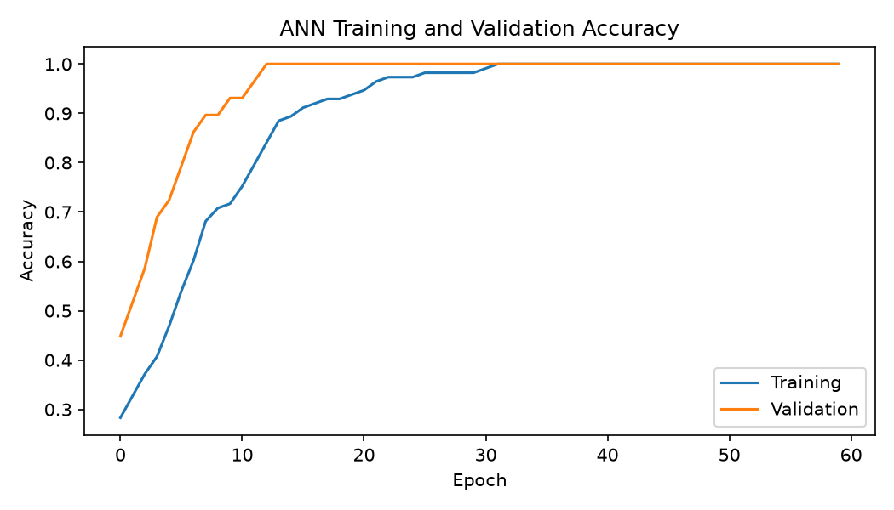

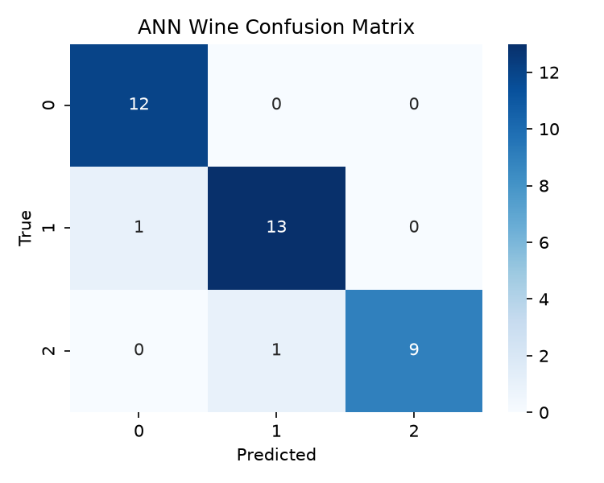

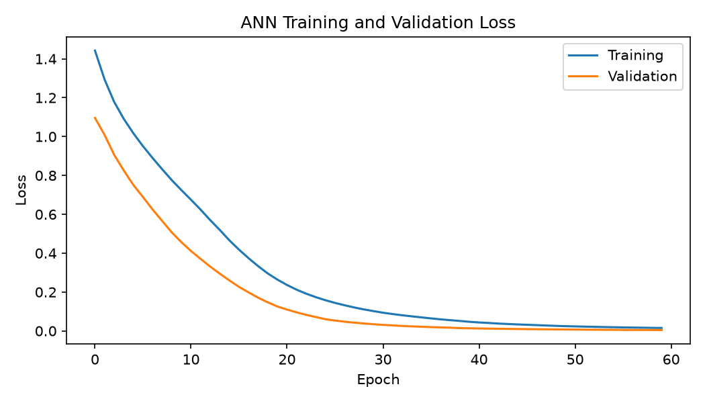

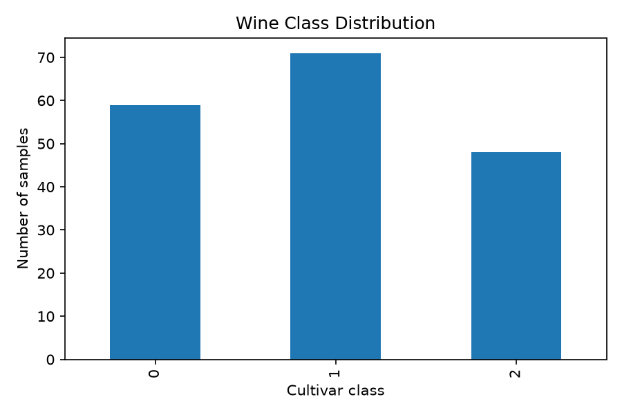

### 2. OpenCV — Image Processing

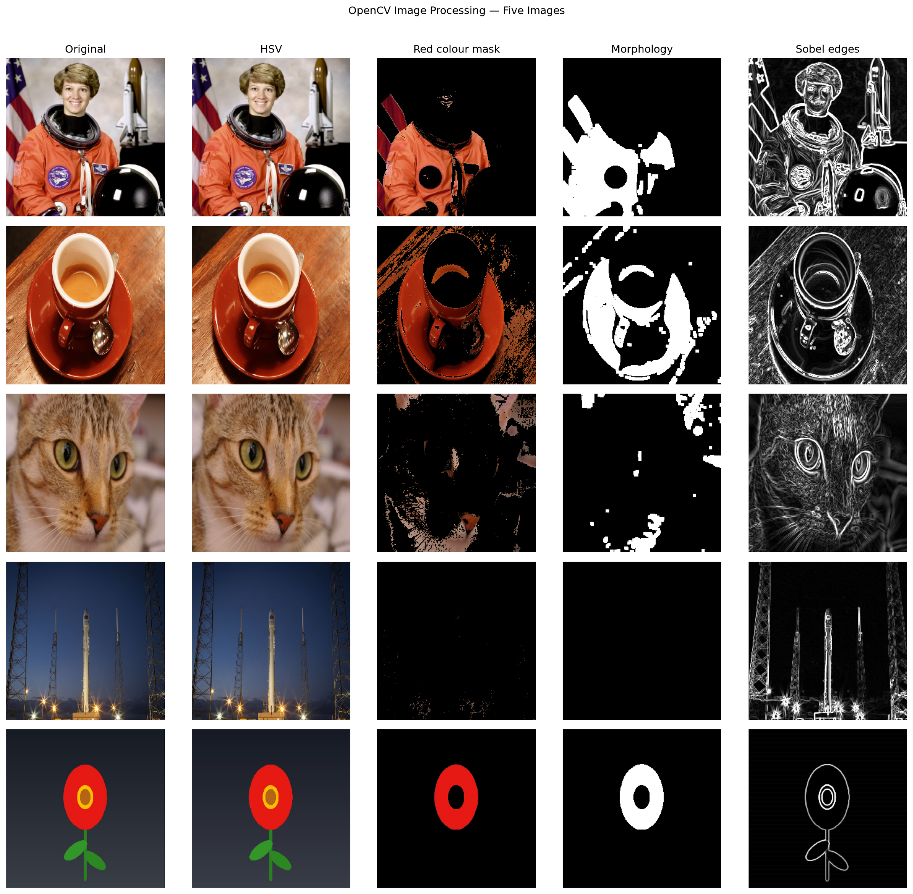

### 3. CNN — MNIST Digit Recognition

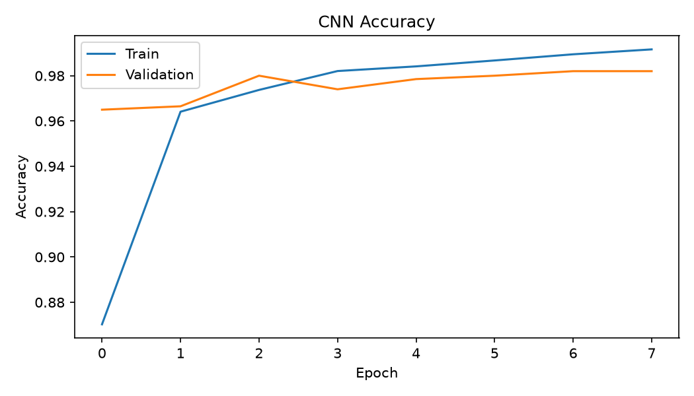

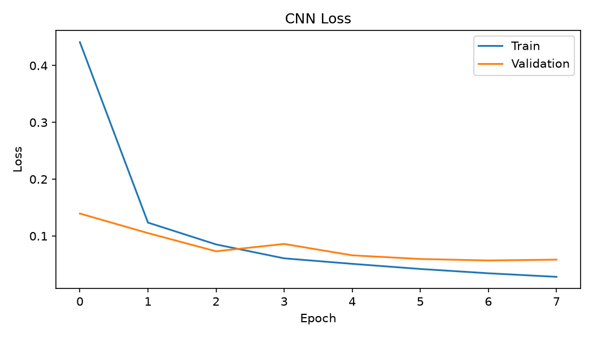

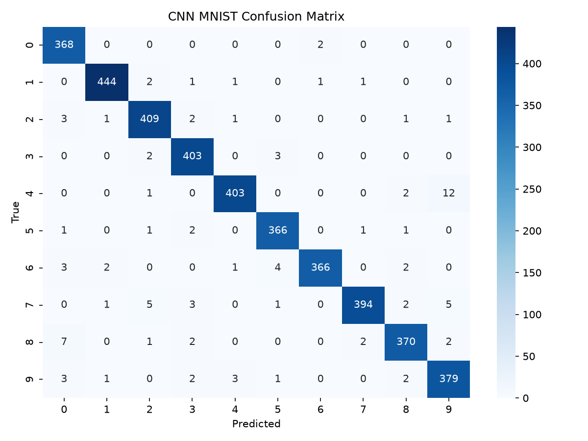

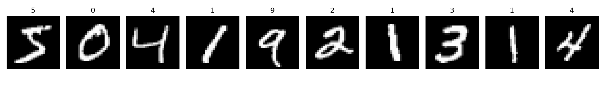

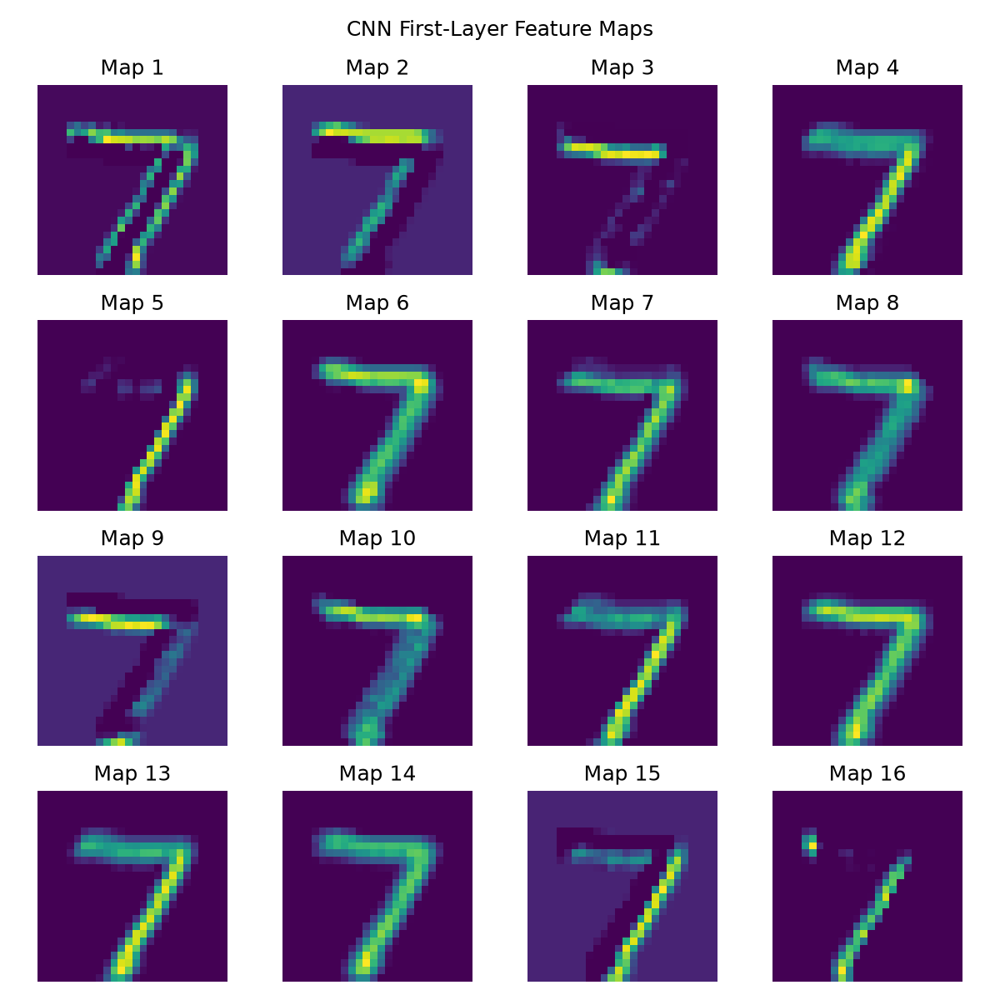

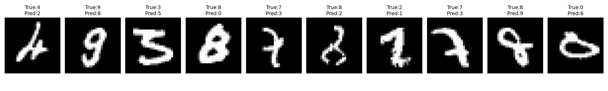

### 4. RNN — GRU Temperature Forecasting

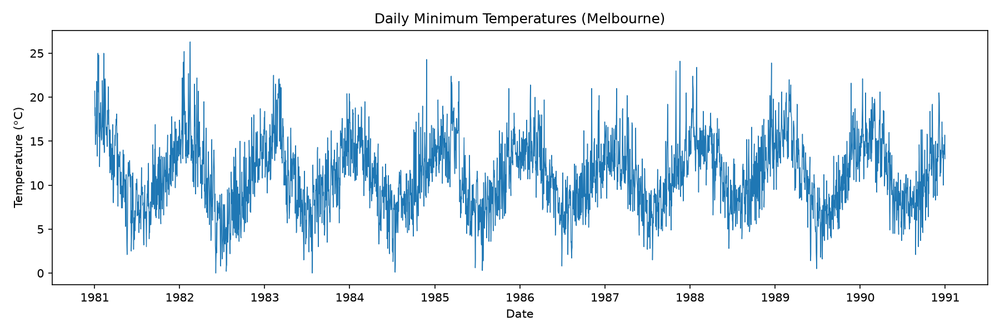

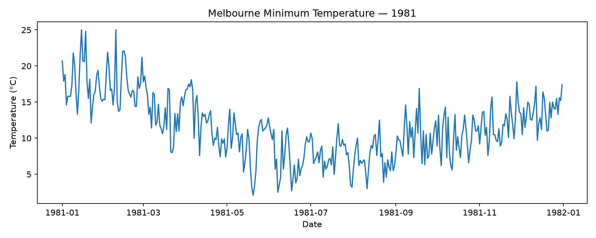

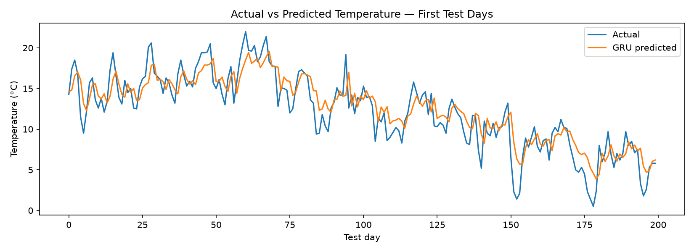

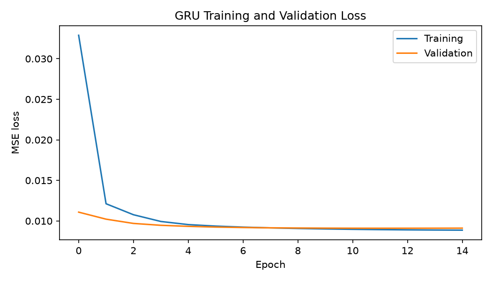

### 5. Transformers — Question Answering

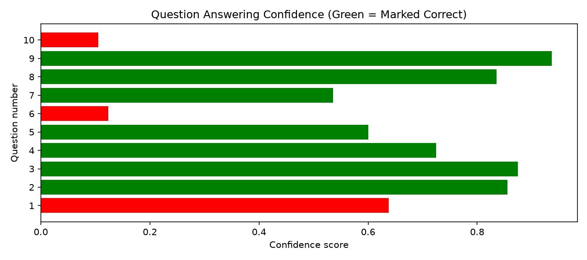

## Requirements

The notebook uses Python packages including:

- `numpy`
- `pandas`
- `matplotlib`
- `scikit-learn`
- `tensorflow` / `keras`
- `opencv-contrib-python`
- `scikit-image`
- `transformers`
- `torch`

Install dependencies in the same Python environment selected by Jupyter/VS Code. Avoid installing conflicting OpenCV distributions together, and restart the kernel after changing OpenCV packages.

## How to run

1. Open `DeepLearning_Practical_Exam_SetC.ipynb` in Jupyter Notebook or VS Code.
2. Select the Python environment where the dependencies are installed.
3. Run notebook cells in order.
4. Internet access may be required to download datasets and pretrained model weights.
5. Run the notebook's export/plot cells to regenerate the images in `outputs/`.

### OpenCV Haar-cascade troubleshooting

Before face detection, confirm the Haar cascade XML file exists and loaded correctly. For example:

```python
face_cascade = cv2.CascadeClassifier(str(cascade_path))
if face_cascade.empty():
    raise FileNotFoundError(f"Could not load Haar cascade: {cascade_path}")
```

Use the actual location of `haarcascade_frontalface_default.xml` on your computer. Do not call `detectMultiScale` if `face_cascade.empty()` is `True`.

## Notes

- The images included here are the supplied result plots; rerunning training may produce slightly different results.
- Transformer APIs vary by version. Use pipeline tasks supported by the Transformers version installed in your environment.
- The README describes the supplied notebook and result images; it does not claim that every notebook cell was rerun during packaging.
